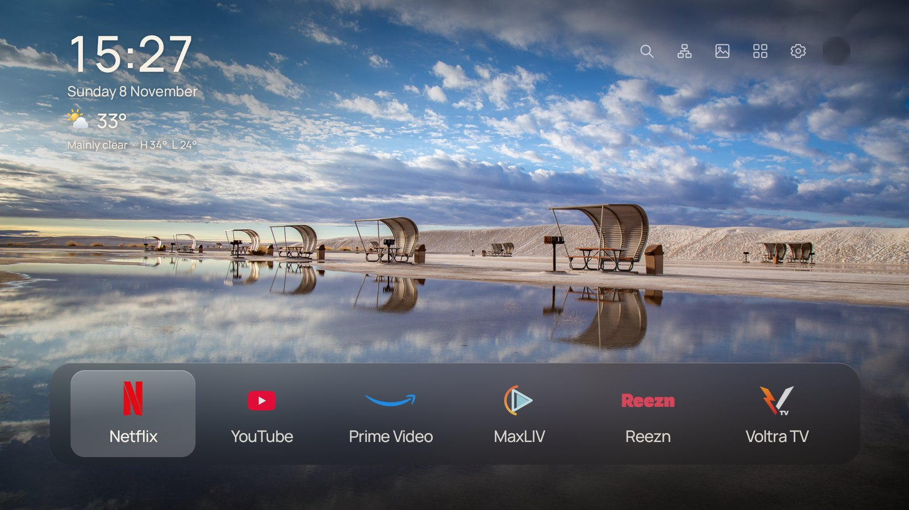
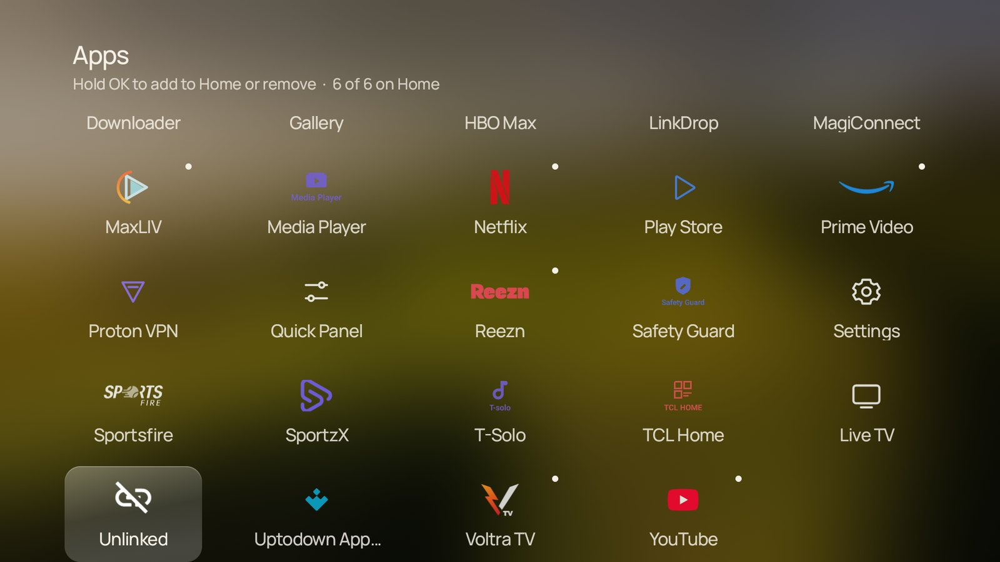

# CleanHome

**A calm, clean home screen for Google TV.** No ads, no promoted rows, no clutter: just a beautiful photo,
the time, the weather and the apps you actually use.

CleanHome replaces the busy Google TV home screen with a quiet one inspired by Apple TV and
[CleanFrame](https://github.com/nthnclrk/CleanFrame). Everything you rely on keeps working: the Google
Assistant voice button, Chromecast, AirPlay, the Play Store, your accounts and automatic system updates.

## What you get

- **Big clock, date and live weather** for your area, with colour weather icons.
- **A dock of up to 6 favourite apps** with consistent brand-coloured logos, for every app, including ones you install later.
- **Live wallpapers from Google**: a new picture every hour on the hour, straight from the internet and no repeats for months - the same kind of photos as the Google TV screensaver (or Google Arts & Culture masterpieces). Bing's photo of the day and a built-in set are there too.
- **Smooth, gentle animations** and the familiar navigation sounds.
- **All apps** in a neat, evenly spaced grid. Hold OK on any app to add it to (or remove it from) the dock.
- **Search** for apps, or search Google TV and YouTube, by typing or by voice.
- **Back on the home screen starts Google's screensaver**, with a soft fade.
- **The remote's Settings button** opens Google TV's normal quick settings. The account icon opens your profile.
- Text stays readable on bright photos: the area behind the clock and dock is darkened just enough.
- **Optional clean-up** that switches off Google TV feedback/telemetry apps and, on TCL TVs, TCL's tracking and bloat apps. Nothing is uninstalled, and it's fully reversible.

## Install (about 5 minutes)

You need a **Google TV** (TCL, Sony, Hisense, Philips, Chromecast with Google TV, ...) and a **computer**
(Mac, Windows or Linux) on the **same Wi-Fi/network** as the TV.

1. **On the TV, turn on network debugging** - [step-by-step guide](docs/INSTALL.md#1-turn-on-network-debugging-on-the-tv)
   (Settings > System > About > click *Android TV OS build* 7 times, then
   Settings > System > Developer options > *USB debugging* **On**).
2. **Find the TV's IP address**: Settings > Network & Internet > your network (for example `192.168.1.50`).
3. **On the computer, download** [**CleanHome-installer.zip**](https://github.com/SamirHarawa/CleanHome/releases/latest/download/CleanHome-installer.zip)
   and unzip it.
4. **Run the installer** from inside the unzipped folder, using your TV's IP address:

   | Computer | Do this |
   |---|---|
   | **Mac / Linux** | Open *Terminal* in the folder and run: `./install.sh 192.168.1.50` |
   | **Windows** | Right-click the folder > *Open in Terminal*, then run: `powershell -ExecutionPolicy Bypass -File .\install.ps1 192.168.1.50` |

5. **The TV asks "Allow debugging?"** - tick *Always allow from this computer* and choose **OK**.

That's it. The installer downloads anything it needs, installs CleanHome and sets it up. Press **Home** on the remote.

Want the clean-up too? Add `--debloat` (Mac/Linux) or `-Debloat` (Windows) to the command.

Full guide with pictures and answers to common problems: **[docs/INSTALL.md](docs/INSTALL.md)**.

## Using it

| Remote button | On the CleanHome screen |
|---|---|
| **Arrows / OK** | Move around and open apps. |
| **Hold OK** on a dock app | Move it, or remove it from the dock. |
| **Hold OK** on an app in *Apps* | Add it to the dock (or remove it). |
| **Back** | Start the screensaver. Any button wakes the TV back to CleanHome. |
| **Settings** (gear) | Google TV quick settings (picture, sound, inputs, network...). |
| **Home** | Always brings you back to CleanHome. |
| **Microphone** | Google Assistant, as usual. |

The icons at the top right are: Search, Network, Wallpaper, Apps, Quick settings and Account.
More in **[docs/USING.md](docs/USING.md)**.

## Remove it

Run `./uninstall.sh 192.168.1.50` (or `.\uninstall.ps1 192.168.1.50` on Windows) from the same folder.
It turns back on any apps the clean-up switched off, restores TCL's settings if they were changed, removes
CleanHome and returns your TV to the normal Google TV home.

## Good to know

- **Privacy.** CleanHome has no accounts, ads or analytics. It only goes online to fetch wallpapers (Google's
  Chromecast ambient feed, Google Arts & Culture and Bing) and the weather (an approximate location from your internet connection via
  ipwho.is, and the forecast from Open-Meteo). Details in [docs/HOW-IT-WORKS.md](docs/HOW-IT-WORKS.md).
- **Updates.** Google TV system updates keep working. To update CleanHome, run the installer again.
- **Tested on** a TCL Google TV (Android 14). It is built for any Google TV running Android 9 or later; other brands
  should work the same way - please [open an issue](https://github.com/SamirHarawa/CleanHome/issues) if something doesn't.

## For developers

CleanHome is a small, dependency-free Android app (no Gradle). See [docs/BUILD.md](docs/BUILD.md) to build it
and [docs/HOW-IT-WORKS.md](docs/HOW-IT-WORKS.md) for how it hooks into Google TV.

## Credits and licence

CleanHome is MIT licensed - see [LICENSE](LICENSE). Its look is a port of
[CleanFrame](https://github.com/nthnclrk/CleanFrame) by Nathan Clark (MIT). Photographs are by the credited
Unsplash photographers, the Manrope font is under the SIL Open Font Licence, and brand logos belong to their
owners. See [THIRD_PARTY_NOTICES.md](THIRD_PARTY_NOTICES.md). CleanHome is not affiliated with Google, TCL or any
streaming service.
