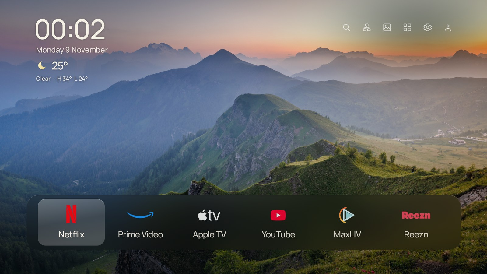
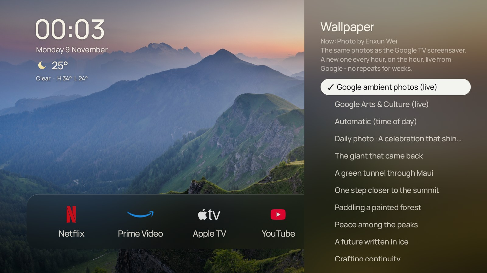

# Using CleanHome

## The home screen

- **Top left:** the time, the date, and the weather for your area (temperature and town, then the conditions and
  today's high and low). The weather updates every 30 minutes.
- **Top right**, from left to right:

  | Icon | What it does |
  |---|---|
  | Search (magnifier) | Opens search. Press OK to type, or choose the mic to speak. Matching apps appear first; you can also search Google TV or YouTube. |
  | Network | Shows whether you're on Ethernet or Wi-Fi (with signal strength). Opens the network settings. |
  | Wallpaper | Choose the background (see below). |
  | Apps | All your apps. |
  | Quick settings (gear) | Google TV's own quick settings panel. |
  | Account (your picture) | Google TV's profile chooser: switch profile, add an account, manage accounts. |

- **Bottom:** the dock with up to 6 apps.

## The remote

| Button | What happens |
|---|---|
| **Arrows / OK** | Move and open. A soft click plays as you move. |
| **Back** | Closes whatever is open. On the plain home screen it starts the screensaver. |
| **Home** | Always returns to CleanHome. |
| **Settings button** | Google TV quick settings, from anywhere. |
| **YouTube button** (on remotes that have one) | Opens YouTube. |
| **Microphone** | Google Assistant. |

## Arranging the dock

- **Add an app:** open **Apps**, move to the app and **hold OK** (or press the Menu button). A small dot marks apps that
  are on the dock. The dock holds up to 6 apps.
- **Move or remove:** on the dock, **hold OK** on an app and choose *Move left*, *Move right* or *Remove from Home*.

## Wallpapers

Open the **Wallpaper** icon. Moving over a choice previews it; OK keeps it; Back cancels.

- **Google ambient photos (live)** - the default. The same kind of photos as the Google TV screensaver, fetched live from
  Google: a new one every hour, exactly on the hour (7:00, 8:00...), never repeated for months (CleanHome remembers the last 2,000 it showed). Only the
  current and next photo are kept on the TV. The list shows the photographer of the one on screen.
- **Google Arts & Culture (live)** - museum masterpieces instead, also a new one every hour on the hour.
- **Daily photo** - Bing's photo of the day, in 4K.
- **Automatic** - built-in photos that follow the time of day (dawn, morning, midday, afternoon, golden hour, dusk, night).
- **Any single built-in photo.**

On bright photos CleanHome quietly darkens the area behind the text and the dock so everything stays readable.

## App logos

Every app gets a clean logo in its own brand colour, so the dock and the Apps grid look consistent - including apps you
install later (CleanHome reads the colour and shape from the app's own icon).

## Screensaver

Press **Back** on the home screen: the home screen fades away and Google's own ambient screensaver fades in.
Press **Back** or **OK** to wake up. (Pressing **Down** in the screensaver opens Google's screensaver options, as usual.)
To change what the screensaver shows (Google Photos, art gallery...), use Settings > System > Ambient mode on the TV.
